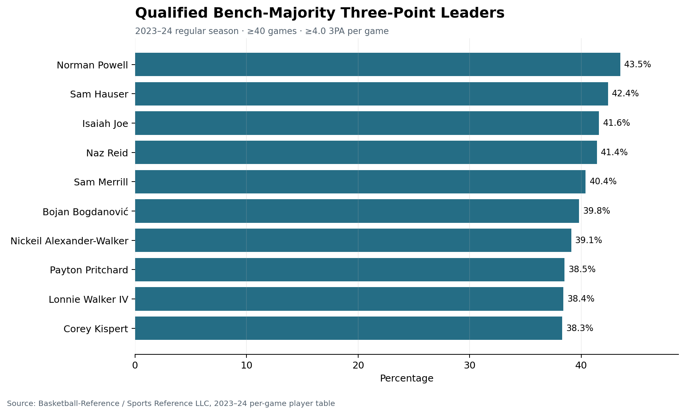

# NBA Bench Impact Analysis

An individual Python and Pandas analysis of 2023–24 NBA regular-season players who appeared off the bench more often than they started. The project ranks qualified rotation players across three-point shooting, two-point shooting, free throws, and rebounding.

[Read the analysis notebook](notebooks/nba_bench_impact_analysis.ipynb) · [Explore the Python source](src/nba_analysis.py) · [View result tables](results/)



*Preview: players with at least 40 games, more bench appearances than starts and at least 4.0 three-point attempts per game. Source: Basketball-Reference / Sports Reference LLC.*

Other result charts: [two-point shooting](assets/figures/two_point_leaders.png) · [free throws](assets/figures/free_throw_leaders.png) · [rebounding](assets/figures/rebounding_leaders.png).

## Skills demonstrated

| Skill | Evidence in this project |
| --- | --- |
| **Python and Pandas data analysis** | [Reusable functions](src/nba_analysis.py) load CSV/Excel, coerce numeric fields, filter records, group by player and build sorted leaderboards. |
| **Data cleaning and deduplication** | Multi-team season-row selection prevents double counting; required columns and impossible games/starts combinations are checked in [source](src/nba_analysis.py). |
| **Exploratory data analysis and cohort design** | Transparent games-played, bench-appearance and shot-attempt thresholds make comparisons inspectable. |
| **Matplotlib data visualization** | Consistent charts show percentage/rate labels, threshold context and source attribution; [chart function](src/nba_analysis.py). |
| **Jupyter and reproducible analysis** | The [executed notebook](notebooks/nba_bench_impact_analysis.ipynb) connects preparation, cohort counts, rankings and exported results. |
| **pytest and analytical validation** | [Tests](tests/test_nba_analysis.py) exercise multi-team deduplication, cohort eligibility and leaderboard sorting. |

## Why this project matters

Bench-player comparisons are easy to distort through small samples and traded-player duplicates. This analysis improves the original coursework by:

- retaining the aggregate `2TM`/`3TM` season row for traded players;
- requiring at least 40 games for the core cohort;
- publishing the attempt thresholds used for each shooting leaderboard;
- separating source data, analysis logic, tests, results, and presentation;
- excluding the raw third-party dataset from the repository.

## Verified findings

After selecting one row per player, the analysis contains 572 unique regular-season player records. The defined cohort contains 185 players who appeared in at least 40 games and came off the bench more often than they started.

- Norman Powell led qualified three-point shooters at 43.5% on 5.1 attempts per game.
- Walker Kessler led qualified two-point shooters at 68.0% on 5.2 attempts per game.
- Bogdan Bogdanović led qualified free-throw shooters at 92.1% on 2.1 attempts per game.
- Andre Drummond led the cohort with 9.0 rebounds per game.

These findings describe the stated cohort and thresholds, not every NBA player.

## Method

1. Load the regular-season per-game player table.
2. Collapse team-stint duplicates by keeping the multi-team aggregate row.
3. Calculate `Bench Games = G - GS`.
4. Keep players with at least 40 games and `Bench Games > GS`.
5. Rank shooting percentages only after applying per-game attempt thresholds:
   - three-pointers: `3PA >= 4.0`
   - two-pointers: `2PA >= 5.0`
   - free throws: `FTA >= 2.0`
6. Rank rebounders by total rebounds per game.

## Repository structure

```text
assets/figures/     Recruiter-facing result charts
data/README.md      Manual source-data instructions and usage boundary
notebooks/          Executed analysis narrative
results/            Compact derived leaderboards
src/                Reusable cleaning and analysis functions
tests/              Data-selection and cohort tests
```

## Run locally

```bash
python -m venv .venv
source .venv/bin/activate
pip install -r requirements.txt
```

Follow [`data/README.md`](data/README.md) to obtain the source table, then run:

```bash
pytest -q
python -m jupyter nbconvert --to notebook --execute --inplace \
  notebooks/nba_bench_impact_analysis.ipynb
```

For a private Excel copy of the original workbook, set `NBA_DATA_PATH` before execution. The public package does not include that workbook.

## Data provenance and responsible use

The statistical source is the [Basketball-Reference 2023–24 NBA per-game player table](https://www.basketball-reference.com/leagues/NBA_2024_per_game.html), provided by Sports Reference LLC. Sports Reference asks users to credit the source and places restrictions on automated access, competing databases, and AI use. This repository therefore:

- does not include the raw source table;
- does not scrape or automate collection from the website;
- does not use the data for machine-learning or generative-AI training;
- includes only a small set of derived rankings and original charts with attribution.

Review the current [Sports Reference Terms of Use](https://www.sports-reference.com/termsofuse.html) before reusing the source data.

## Limitations

- Per-game statistics do not measure defense, lineup context, role difficulty, or playoff performance.
- The bench-majority definition is operational rather than an official NBA role label.
- Attempt and games-played thresholds are analytical choices and can change rankings.
- Results describe the 2023–24 regular season and should not be treated as current-player evaluations.

## Attribution

Analysis, code, tests, and charts: Vansh Verma. Statistical data: Basketball-Reference / Sports Reference LLC.

## License

The original code and documentation are available under the MIT License. Third-party data is excluded and remains subject to its source terms. See [`NOTICE.md`](NOTICE.md).
